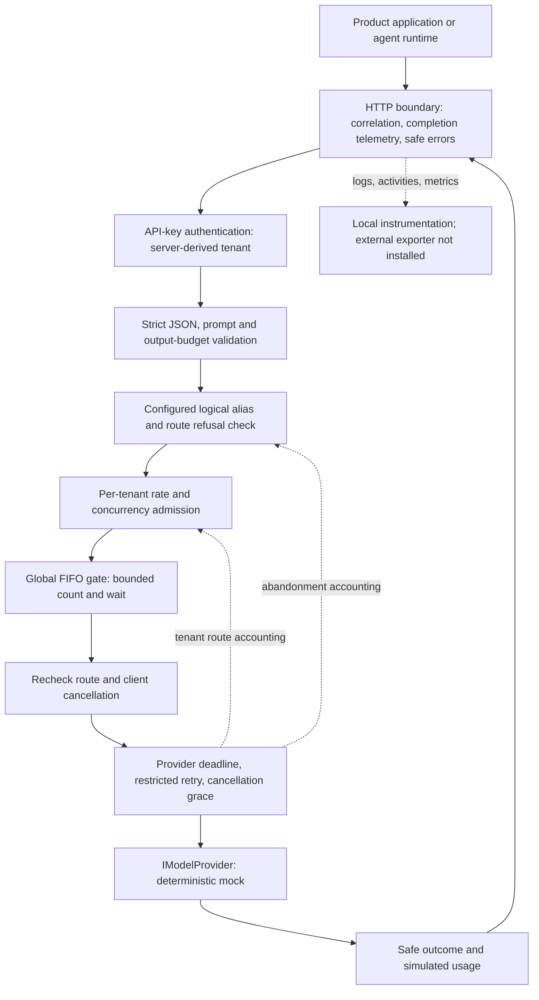

# Architecture — M3

This is a single-process, offline reference service demonstrating shared model-invocation controls.
It is not AVEVA software or a description of any company's internal systems. It has no real inference,
persistent data store, cloud deployment, agent runtime or production identity integration.

## Runtime boundary

The API project keeps boundaries in folders rather than separate assemblies. `GenerateEndpoint` owns
HTTP parsing and response mapping; `GenerationService` owns admission; `ProviderInvoker` owns execution;
`IModelProvider` owns provider behavior. `Observability` owns the telemetry field allowlist. None of the
policy classes needs a vendor SDK. There is no database transaction spanning these operations.

## Request lifecycle and invariants

1. Every request gets a new correlation ID, independent of incoming headers. Completion instrumentation
   surrounds the exception handler, authentication, authorization and endpoints. Empty HTTP errors use
   the same Problem Details format. Liveness is anonymous and does not call providers.
2. Authentication maps a configured API-key digest to a tenant claim. Strict parsing rejects unknown,
   duplicate and incorrectly cased JSON members. Invalid requests and unknown aliases consume no quota.
3. A route with too many outstanding abandoned calls is refused before quota acquisition. Tenant admission
   is atomic under a per-tenant lock: concurrency and route-specific abandoned work, then rate credit.
4. An admitted request holds a tenant lease while waiting for a global permit. The FIFO queue has both
   a size limit and a wait deadline. Full/expired capacity produces 503; a tenant quota produces 429.
5. After obtaining a permit, the route is checked again. A disconnected caller is checked before dispatch.
   Once provider execution starts the quota token is spent, including provider admission failures.
6. One provider deadline covers attempts and backoff. Only failures explicitly guaranteed not processed
   can be retried. A cooperative cancelled call retains its permit while stopping. A result arriving during
   the cancellation grace period is mapped according to its actual outcome.
7. Work still running after grace is abandoned. Its permit and tenant slot are released, but route and
   tenant-on-route counters remain until the task ends. This preserves availability for healthy routes,
   at the cost of allowing actual work to exceed the permit count for defective adapters.
8. Disposing the leases releases capacity and refunds rate credit if no provider phase began. Completion
   telemetry records the HTTP result or client cancellation without recording prompt/output text.

The approximate **admission and execution** budget is `MaxQueueWaitMs + ProviderTimeoutMs +
CancellationGraceMs`. It excludes request-body upload, response transfer and scheduler delays; it is not
a hard wall-clock request SLA. `Task.Run` cannot guarantee timer progress under thread-pool starvation.

## State and ownership

| State | Owner / lifetime | Consequence |
| --- | --- | --- |
| Tenant keys and routes | Configuration and immutable-by-convention singleton snapshots | Restart to change policy; plaintext development keys remain in configuration memory |
| Rate credit and active tenant leases | `TenantQuotaService`, process memory | Atomic locally; restart resets credit; replicas do not share quotas |
| Provider permits and FIFO waiters | `ProviderConcurrencyGate`, process memory | One shared queue across routes; FIFO is not weighted tenant fairness |
| Outstanding abandoned calls | `ProviderInvoker` plus tenant route accounting | A timeout response does not prove upstream work stopped |
| Tenant telemetry pseudonym key | `AiCoreTelemetry`, random per host | Stable only for the host lifetime; no cross-replica tenant analytics |
| Prompts and completions | Request/provider task memory | No application persistence; abandoned tasks can retain data until they finish |
| Logs | JSON console sink | Retention/access control belongs to the operator; there is no audit ledger |

## Observability

See [the telemetry contract](observability.md) for names, units, boundaries and collection instructions.
Request completion distinguishes authentication/validation rejection, tenant quota, global overload,
provider failure, timeout and cancellation. Queue and provider phase durations are separate. Permit use,
queue depth and abandoned work are separately measurable: a free permit does not imply no orphan work.

Counters are unsampled. Activities are emitted only when a listener subscribes; no trace store, exporter,
dashboard, SLO or alerting service is configured. Successful mock token counts are simulated estimates,
not a billing record. The test listener demonstrates instrumentation without external services.

## Security and trust boundaries

| Boundary / threat | Implemented control | Remaining obligation |
| --- | --- | --- |
| Caller impersonates another tenant | Only authenticated `tenant_id` is used; body identity is rejected | Replace development keys with validated issuer/audience/signature/lifetime and explicit tenant/model authorization |
| Caller consumes resources | Kestrel body cap; prompt/output-budget validation; tenant and shared admission bounds | Edge request-rate/connection limits before parsing/authentication; test body caps over real Kestrel |
| Request data leaks into telemetry | Allowlisted fields, host-keyed tenant HMAC, no exception messages or JSON paths; T-08 regression tests | Review SDK, proxy, exporter and infrastructure diagnostics separately; restrict log access and retention |
| Provider returns unsafe/oversized data | Mock respects its output budget; endpoint returns output only to its caller | A real adapter must enforce response byte/token bounds and handle untrusted generated content |
| Provider hangs or ignores cancellation | Deadline, grace and bounded route refusal | Process/container isolation for blocking/untrusted adapters; upstream cancellation or billing reconciliation |
| Credentials/configuration are exposed | Keys absent from committed appsettings; startup validation does not print key values | Secret store, rotation/revocation, workload identity, TLS and outbound network policy |
| Tools or model output cause side effects | No tool execution exists | Tool authorization, sandboxing, approval and audit belong to a separate governed tool service |

Configuration is an operator trust boundary: model/provider names and validation key paths may appear in
diagnostics and must not contain secrets. Tenant pseudonyms, trace IDs, usage and timing remain sensitive
metadata. Pseudonymization is not anonymization. An adapter running in this process can log or exfiltrate
data directly; dropping exception messages does not sandbox it.

There is no per-model entitlement, content safety service, TLS termination policy, durable audit trail,
tenant data residency routing, encryption-at-rest policy or deletion workflow here. Those omissions are
deployment blockers for an enterprise service, not evidence that this demo secretly implements them.

## Scaling path and failure domains

With `N` replicas, tenant rate/burst limits can be consumed on each replica and the platform has `N × C`
permits, where `C` is the configured local concurrency. Sticky routing reduces some drift but cannot
guarantee a quota across failover, restarts or deliberate routing changes.

An enterprise implementation would separate global admission policy from local overload protection:

- Enforce shared rate/token budgets atomically, for example using a Redis script keyed by verified tenant.
  Define fail-closed versus a small explicit local allowance during store outages. A check followed by a
  separate decrement is racy. Distributed concurrency requires expiring leases, ownership and recovery;
  a Redis counter alone leaks on worker crashes and is not a complete design.
- Retain local queue and permit bounds even with distributed quotas. Partition provider capacity by route
  or provider when one slow route can fill the common queue. Use weighted scheduling if tenant service
  classes need guaranteed shares. Do not add an unbounded background queue to hide overload.
- Scale on queue delay, rejection ratio, execution duration and upstream headroom together. Increasing
  replicas can multiply upstream calls, retries and allowed spend. Validate throughput with a real adapter,
  mixed tenants, realistic token sizes, failures and sustained load before assigning an SLO.
- For an adapter that ignores cancellation, the per-route orphan bound is below `A + C` (`A` is the
  route threshold); across many routes and replicas these allowances accumulate. Isolate defective work
  in supervised workers if strict physical execution bounds are required.
- Use managed identity/short-lived tokens, centralized policy, secret rotation, approved provider endpoints,
  regional routing and a telemetry collector with explicit retention/access policies before deployment.

No cloud sizing, cost or production throughput can be inferred from the deterministic mock or the existing
100-request concurrency test. That test demonstrates a bound under controlled scheduling.

## Provider extension and platform ownership

Register another `IModelProvider` and map an alias to its stable name/model. The endpoint need not change;
the test host already registers a second adapter this way. Confirm that startup route validation, failure
classification, cancellation, usage normalization and response bounds are adequate before using real traffic.

Streaming needs a distinct streaming contract: first-token latency, disconnect cleanup, partial responses,
usage completion and errors after headers are sent differ from this buffered endpoint. Tool calling and
multimodal input need explicit capability negotiation rather than vendor JSON hidden inside the prompt.
Provider-specific options can be versioned extensions; a universal interface must not silently discard
capabilities. Retry safety must come from a documented upstream guarantee, not a guess based on status code.

The platform owns identity, routing, admission, provider credentials, normalized errors and telemetry.
Product/agent teams own prompts, planning, task state, memory and evaluation. A governed tool service owns
tool permissions and side effects. These boundaries avoid turning the invocation API into an agent runtime.

See the [decision records](decisions/README.md) and [technical assessment](architecture-review.md).
